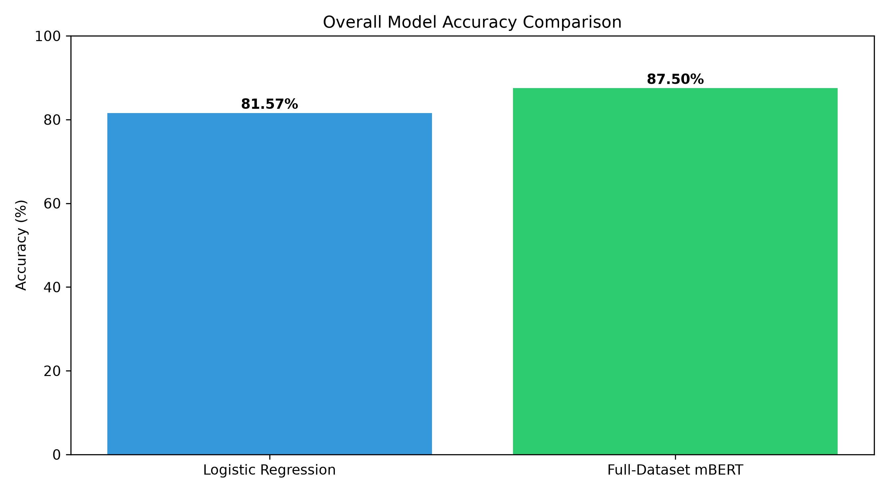
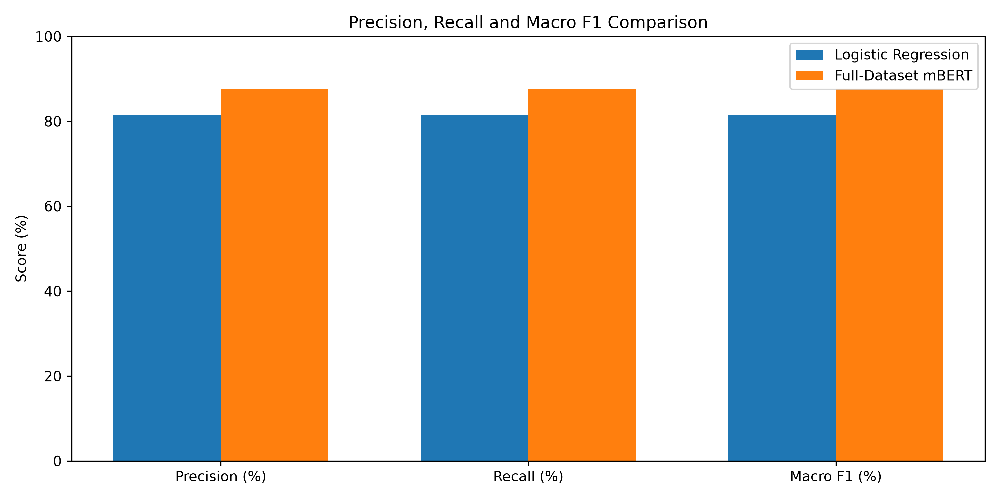
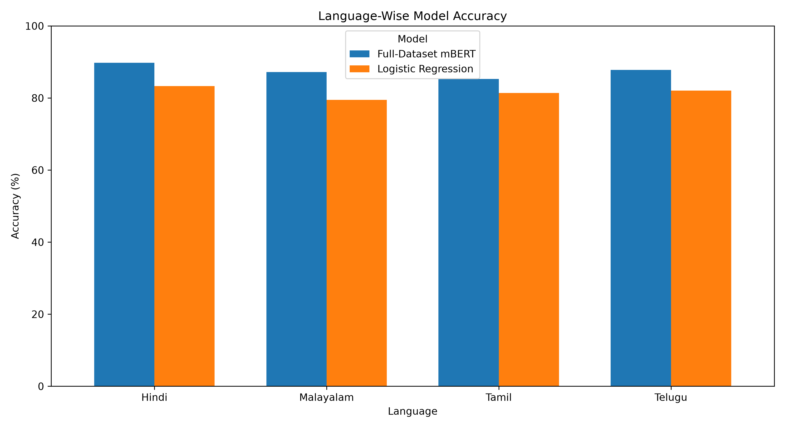
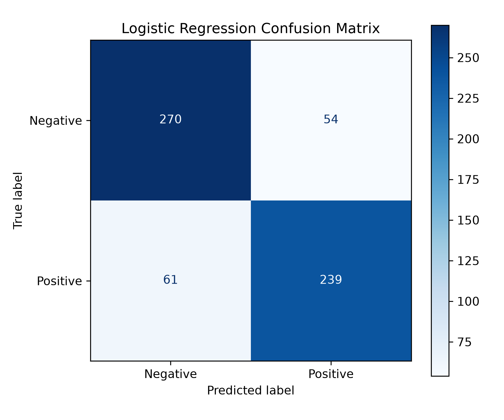
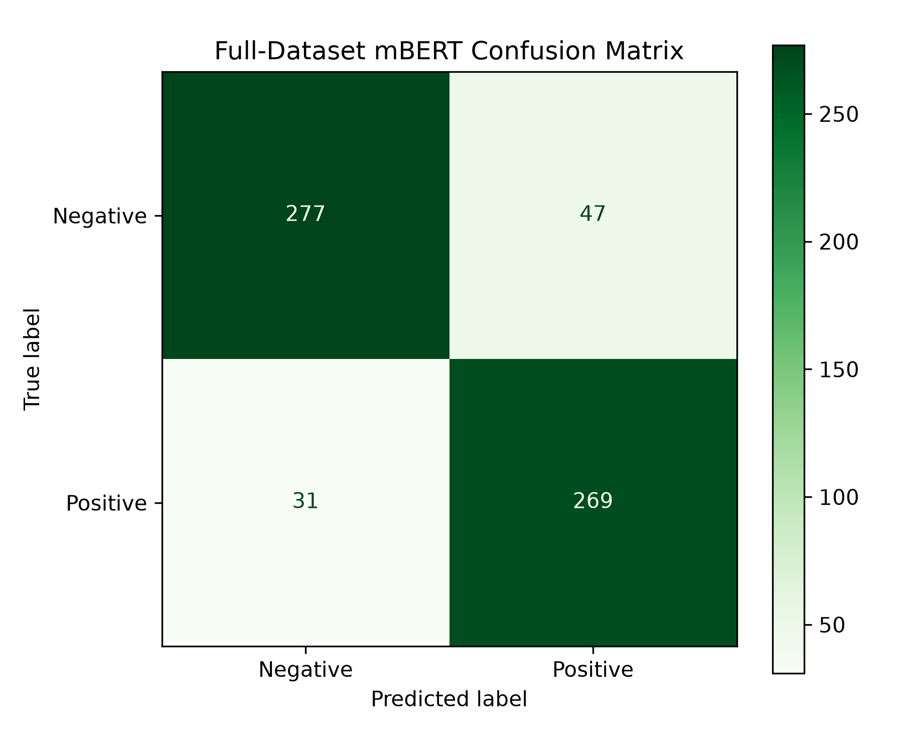

# 🌍 Multilingual Sentiment Analysis Using Machine Learning and Multilingual BERT

**Binary sentiment classification for English, Hindi, Telugu, Tamil, and Malayalam — with a comparative Streamlit interface.**

[](https://www.python.org/)
[](https://streamlit.io/)
[](https://huggingface.co/docs/transformers/)
[](#project-overview)

> **Best validation accuracy: 87.50% (fine-tuned mBERT)**, compared with **81.57% (TF-IDF + Logistic Regression)** on the same 624-review validation set.

### 🎬 Project presentation video

**[▶ Watch our project presentation on Google Drive](https://drive.google.com/file/d/1BKn779L0ujrRD9YcpQQWPXD1pHXu-z6k/view?usp=drive_link)**

*The video is hosted externally. Google Drive viewing permissions must allow visitors to access it.*

## Table of contents

- [Project overview](#project-overview)
- [Problem statement and objectives](#problem-statement-and-objectives)
- [Team](#team)
- [Dataset](#dataset)
- [Methodology and system architecture](#methodology-and-system-architecture)
- [Development phases](#development-phases)
- [Evaluation and results](#evaluation-and-results)
- [Visualizations](#visualizations)
- [Streamlit application](#streamlit-application)
- [Repository structure](#repository-structure)
- [Installation and local execution](#installation-and-local-execution)
- [Reproducibility and model availability](#reproducibility-and-model-availability)
- [Limitations and future work](#limitations-and-future-work)
- [Acknowledgments](#acknowledgments)

## Project overview

Online reviews and user feedback appear in many languages, but sentiment-analysis systems often emphasize English. This project studies **positive/negative sentiment classification** for five languages:

| Language | Native name |
|---|---|
| English | English |
| Hindi | हिन्दी |
| Telugu | తెలుగు |
| Tamil | தமிழ் |
| Malayalam | മലയാളം |

We implemented and compared two modeling approaches:

1. **Traditional machine learning:** character-level TF-IDF features (2–5 character n-grams) and class-balanced Logistic Regression.
2. **Transformer-based deep learning:** fine-tuning `bert-base-multilingual-cased` (mBERT) for binary sentiment classification.

A **Streamlit application** provides an interface for entering reviews and comparing predictions from the available models.

## Problem statement and objectives

### Problem

Sentiment can be expressed differently across languages and scripts. A classifier should recognize sentiment-bearing patterns without requiring users to translate every review into English.

### Objectives

- Prepare and inspect a multilingual labeled review corpus.
- Audit language coverage, duplication, and potential train/validation leakage.
- Establish a reproducible TF-IDF + Logistic Regression baseline.
- Experiment with multilingual BERT fine-tuning and compare training configurations.
- Evaluate accuracy, macro-averaged classification metrics, confusion matrices, and per-language accuracy.
- Build an interactive Streamlit interface for model comparison.

## Team

| Name | PRN |
|---|---|
| **Ghana Sai Reddy Kodumuru** | **24070722011** |
| **Sri Charan Rao Kondapalkula** | **24070722013** |

**Institution:** Symbiosis Institute of Technology, Hyderabad  
**Department:** Artificial Intelligence and Machine Learning  
**Academic year:** 2026–2027

## Dataset

### Data split

| Split | Number of reviews | Notes |
|---|---:|---|
| Training | **35,277** | Five languages |
| Validation | **624** | 156 reviews each in Hindi, Telugu, Tamil, Malayalam |
| Held-out test | **3,992** | Independent test results not reported here |

### Training distribution

| Language | Reviews |
|---|---:|
| Hindi | 7,538 |
| English | 6,956 |
| Tamil | 6,937 |
| Malayalam | 6,928 |
| Telugu | 6,918 |
| **Total** | **35,277** |

**Sentiment labels (training):** 18,992 positive and 16,285 negative.

**Important evaluation note:** The reported validation results cover **Hindi, Telugu, Tamil, and Malayalam**; English has no examples in the 624-review validation set. Therefore, these scores do **not** establish English-language validation performance. Parts of the training corpus are synthetic or translated, which may affect real-world generalization. Dataset files are not included in this repository.

## Methodology and system architecture

```text
                      Multilingual review text
                                |
                                v
                  Data inspection and preprocessing
                                |
                      Training / validation split
                                |
                 +--------------+---------------+
                 |                              |
                 v                              v
      Character-level TF-IDF             mBERT tokenizer
          (2–5 n-grams)                       |
                 |                              v
                 v                     Multilingual BERT
       Logistic Regression                fine-tuning
                 |                              |
                 +--------------+---------------+
                                |
                                v
                   Validation and comparison
                                |
                                v
                     Streamlit application
                                |
                                v
                  Positive / Negative prediction
```

### Baseline: TF-IDF + Logistic Regression

The baseline uses character n-grams to represent text from multiple scripts without requiring a separate word tokenizer for each language. Class-balanced Logistic Regression predicts one of two labels: **positive** or **negative**.

### Transformer: multilingual BERT

The transformer approach fine-tunes **`bert-base-multilingual-cased`** on labeled multilingual reviews. Early experiments were run on CPU; the final full-dataset fine-tuning used a **Google Colab Tesla T4 GPU**.

## Development phases

The repository's scripts are organized around these experimental phases:

| Phase | Focus | Key scripts |
|---|---|---|
| **1** | Data inspection, cleaning, language checks, overlap/leakage audits | `src/phase1_*.py` |
| **2** | TF-IDF + Logistic Regression baseline | `src/phase2_baseline_model.py` |
| **3** | CPU mBERT training and improvement | `src/phase3_mbert_cpu.py`, `src/phase3_mbert_improved.py` |
| **4** | Error diagnosis and multilingual improvements | `src/phase4_model_diagnosis.py`, `src/phase4_multilingual_improvement.py` |
| **5** | Final model comparison and validation evaluation | `src/phase5_final_evaluation.py` |

Supporting preprocessing is available in `src/prepare_training_data.py`.

### mBERT training progression

| Experiment | Validation accuracy |
|---|---:|
| Initial CPU mBERT | 59.62% |
| Improved CPU mBERT | 74.04% |
| Multilingual mBERT v2 (CPU) | 74.52% |
| **Full-dataset mBERT (Colab T4)** | **87.50%** |

These experiments illustrate the impact of training configuration and data coverage; they are not a controlled ablation proving any single factor caused the improvement.

## Evaluation and results

### Overall validation comparison

| Metric | TF-IDF + Logistic Regression | Full-dataset mBERT |
|---|---:|---:|
| **Accuracy** | **81.57%** | **87.50%** |
| Macro F1 | 81.52% | 87.50% |
| Macro precision | — | 87.53% |
| Macro recall | — | 87.58% |

**mBERT improved validation accuracy by 5.93 percentage points** over the baseline.

### Language-wise validation accuracy

| Language | Logistic Regression | Full-dataset mBERT |
|---|---:|---:|
| Hindi | 83.33% | **89.74%** |
| Telugu | 82.05% | **87.82%** |
| Tamil | 81.41% | **85.26%** |
| Malayalam | 79.49% | **87.18%** |

### Confusion matrices

Rows are true labels and columns are predicted labels, ordered **[Negative, Positive]**.

**Logistic Regression:**

```text
                  Predicted
                Neg     Pos
Actual Neg      270      54
Actual Pos       61     239
```

**Full-dataset mBERT:**

```text
                  Predicted
                Neg     Pos
Actual Neg      277      47
Actual Pos       31     269
```

The baseline made **115** incorrect predictions; mBERT made **78** incorrect predictions on the same validation set.

> **Scope of these findings:** The figures above are validation metrics, not results on the 3,992-review held-out test set. Independent test-set performance is not yet reported.

## Visualizations

### Overall accuracy



### Classification metrics



### Accuracy by language



### Confusion matrices

| Logistic Regression | Full-dataset mBERT |
|---|---|
|  |  |

The underlying CSV files and additional plots are in [`results/`](results/).

## Streamlit application

The interface in [`app.py`](app.py) accepts review text and displays **side-by-side predictions** from the baseline and the full-dataset mBERT model when their required artifacts are available locally.

### Example prediction

**Input (Telugu):** `ఈ సినిమా చాలా బాగుంది.`  
**English translation:** “This movie is very good.”

| Model | Predicted sentiment | Prediction confidence for this example |
|---|---|---:|
| Logistic Regression | Positive | 62.76% |
| Full-dataset mBERT | Positive | 99.87% |

**Note:** Prediction confidence for one review is not the same as model accuracy, and should not automatically be interpreted as a calibrated probability.

## Repository structure

```text
Multilingual-Sentiment-Analysis/
├── .gitignore
├── app.py
├── README.md
├── models/
│   └── baseline_logistic_regression.joblib
├── results/
│   ├── 01_accuracy_comparison.png
│   ├── 02_metrics_comparison.png
│   ├── 03_language_accuracy.png
│   ├── 04_baseline_confusion.png
│   ├── 05_mbert_confusion.png
│   ├── final_model_comparison.csv
│   ├── final_language_results.csv
│   └── ...
└── src/
    ├── phase1_data_analysis.py
    ├── phase1_data_cleaning.py
    ├── phase1_leakage_detection.py
    ├── phase2_baseline_model.py
    ├── phase3_mbert_cpu.py
    ├── phase3_mbert_improved.py
    ├── phase4_model_diagnosis.py
    ├── phase4_multilingual_improvement.py
    ├── phase5_final_evaluation.py
    └── prepare_training_data.py
```

The listing is abbreviated; see the GitHub repository for all tracked files. Model weights, datasets, and local environments are intentionally excluded.

## Installation and local execution

### 1. Clone the repository

```powershell
git clone https://github.com/ghanasai/Multilingual-Sentiment-Analysis.git
cd Multilingual-Sentiment-Analysis
```

### 2. Create and activate a virtual environment (Windows PowerShell)

```powershell
python -m venv .venv
.\.venv\Scripts\Activate.ps1
```

### 3. Install dependencies

If a project-specific `requirements.txt` is available, use it:

```powershell
pip install -r requirements.txt
```

Otherwise, install the main application libraries:

```powershell
python -m pip install streamlit pandas numpy scikit-learn joblib torch transformers matplotlib sentencepiece safetensors
```

Exact package versions have not been pinned in this repository; compatibility may vary by Python version and environment.

### 4. Restore local model artifacts

The repository includes the baseline artifact at `models/baseline_logistic_regression.joblib`. The **fine-tuned mBERT checkpoint** is **not published in GitHub**. To run mBERT inference, obtain the trained checkpoint and tokenizer files from the project team and place them in:

```text
models/mbert_full_dataset/
```

Downloading the generic `bert-base-multilingual-cased` checkpoint is **not** equivalent to restoring this project's fine-tuned classifier.

### 5. Launch Streamlit

```powershell
streamlit run app.py
```

Streamlit normally opens the app in a local browser. If you do not have the trained mBERT files, some application features may be unavailable or the app may fail to initialize, depending on its loading logic.

## Reproducibility and model availability

- **Included:** Python scripts, baseline `.joblib` model, validation CSV results, and visualizations.
- **Not included:** datasets and the large fine-tuned mBERT checkpoint.
- **Evaluation:** reported figures come from the validation set. The held-out test set has not been reported here.
- **Model access:** a future release could publish the fine-tuned checkpoint to Hugging Face with appropriate documentation and license checks.
- **Dataset provenance:** review the underlying dataset licenses and synthetic/translated data-generation process before redistribution or broader deployment.

## Limitations and future work

- **Validation language coverage:** the current validation set does not include English.
- **Domain shift:** translated/synthetic data may not fully represent natural, informal user reviews.
- **Code-mixing and transliteration:** evaluate mixed-language text and Romanized Indian-language text.
- **More sentiment categories:** investigate neutral or multi-class sentiment classification.
- **Explainability and calibration:** assess prediction reliability and interpretable error cases.
- **Independent test evaluation:** report results on the held-out 3,992 reviews and additional real-world samples.
- **Deployment:** publish model artifacts responsibly and enable a reproducible hosted demo.

## Acknowledgments

This academic project was developed by students of the **Department of Artificial Intelligence and Machine Learning, Symbiosis Institute of Technology, Hyderabad**, using open-source Python, scikit-learn, Hugging Face Transformers, PyTorch, and Streamlit tooling.

---

**🎥 [Watch the project presentation](https://drive.google.com/file/d/1BKn779L0ujrRD9YcpQQWPXD1pHXu-z6k/view?usp=drive_link)** · **💻 [View the GitHub repository](https://github.com/ghanasai/Multilingual-Sentiment-Analysis)**
